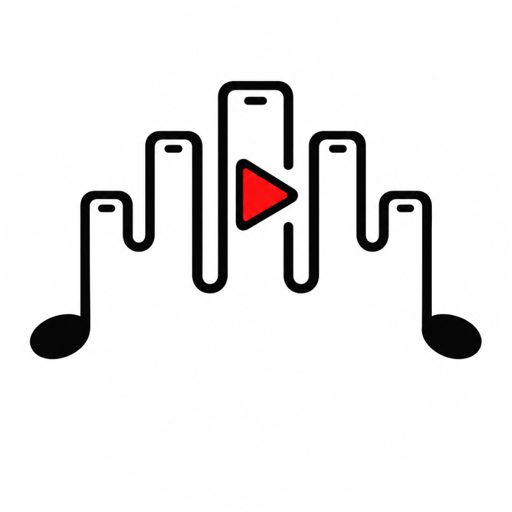
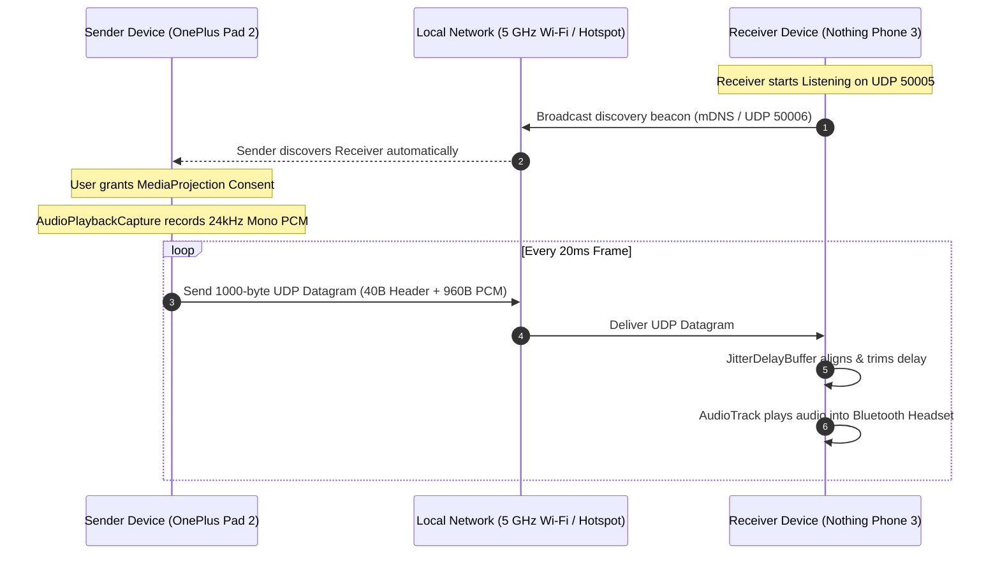
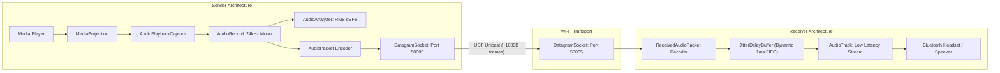
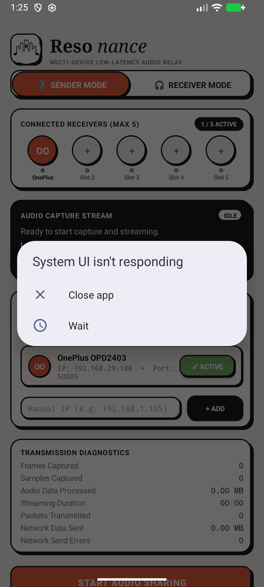

# Resonance

<p align="center">
  
</p>

<p align="center">
  <strong>Low-Latency Multi-Device Audio Sharing for Android</strong><br>
  <em>Explore software-driven audio sharing between companion Android devices and Bluetooth headsets.</em>
</p>

<p align="center">
  
</p>

<p align="center">
  <a href="LICENSE"></a>
  <a href="https://developer.android.com/about/versions/10"></a>
  <a href="app/build.gradle.kts"></a>
  <a href="https://github.com/1ambharath/resonance/releases"></a>
  
</p>

---

## 📑 Table of Contents

- [Overview & Motivation](#-overview--motivation)
- [The Problem & The Software Idea](#-the-problem--the-software-idea)
- [How Resonance Works](#-how-resonance-works)
- [Technical Architecture](#-technical-architecture)
- [Key Features](#-key-features)
- [What Resonance Does Well](#-what-resonance-does-well)
- [Honest Limitations & Known Constraints](#-honest-limitations--known-constraints)
- [Feature Implementation Status](#-feature-implementation-status)
- [Screenshots & Visual Tour](#-screenshots--visual-tour)
- [Download & Installation](#-download--installation)
- [Step-by-Step Setup Guide](#-step-by-step-setup-guide)
- [Android Permissions Explained](#-android-permissions-explained)
- [Build from Source](#-build-from-source)
- [Testing & Quality Verification](#-testing--quality-verification)
- [Troubleshooting](#-troubleshooting)
- [Privacy & Security](#-privacy--security)
- [References & Inspiration](#-references--inspiration)
- [Contributing](#-contributing)
- [License](#-license)
- [Roadmap](#-roadmap)
- [Acknowledgements](#-acknowledgements)

---

## 📖 Overview & Motivation

**Resonance** is an open-source, reproducible Android engineering project exploring software-based audio sharing across local devices. 

Sharing media playback audio (movies, series, lectures) between two people wearing separate Bluetooth headsets in public settings (airplanes, train rides, coffee shops, libraries) is a common dilemma. Many Android devices lack native dual-Bluetooth audio broadcasting, vendor-specific dual-audio solutions are incompatible across brands, and carrying external 3.5mm Bluetooth audio splitter dongles is inconvenient.

Resonance addresses this challenge using devices you already carry: **an Android tablet/phone running as a Sender and a companion Android phone running as a Receiver**, transmitting real-time uncompressed audio over local Wi-Fi.

---

## 💡 The Problem & The Software Idea

### The Problem
- **Dual-Audio Fragmentation**: While certain Android manufacturers offer dual Bluetooth output, these implementations are often proprietary, restricted to identical ecosystem earbuds, or omitted entirely on tablets and budget phones.
- **Hardware Splitters**: Hardware adapters require physical cables, audio jack dongles, or battery-operated external transmitters.

### The Software Idea
Resonance treats two Android devices as synchronized wireless endpoints:
1. **Device A (Sender)**: Plays a video or music stream, captures permitted audio via Android's native `AudioPlaybackCapture` API, and transmits it as lightweight UDP packets across the local network.
2. **Device B (Receiver)**: Listens for the audio stream, buffers incoming PCM frames in a 1 ms precision linear jitter FIFO, and outputs the audio through its own connected Bluetooth headset.
3. **Manual Delay Calibration**: A millisecond-level delay slider allows users to align the two headsets, compensating for differing Bluetooth codec latencies (e.g., aptX vs AAC vs SBC).

> [!NOTE]
> *Exploratory Setup*: The project was conceptually motivated by pairing a **OnePlus Pad 2** (tablet sender) with a **Nothing Phone (3)** (phone receiver), using **Nothing Ear (2)** and **Sony WH-CH520** headsets. Resonance does not claim this exact hardware combination is lab-certified; it provides an inspectable codebase to test and calibrate multi-device setups.

---

## ⚙️ How Resonance Works

Resonance packages both **Sender** and **Receiver** capabilities inside a single unified APK (`com.br.resonance`):



---

## 🏛️ Technical Architecture



For complete technical specifications, threading models, and packet schemas, see [docs/architecture.md](docs/architecture.md).

---

## ✨ Key Features

- **Unified Single-APK Application**: Switch effortlessly between **Sender Mode** and **Receiver Mode** with a single tap.
- **Native OS Capture**: Captures system media audio on Android 10+ using `MediaProjection` and `AudioPlaybackCaptureConfiguration`.
- **Low-Latency UDP Streaming**: Streams raw 16-bit PCM at 24,000 Hz in 20 ms frames without heavyweight compression latency.
- **Multi-Device Broadcast**: Sender can stream concurrent audio to up to **5 receiver devices** simultaneously.
- **1-Millisecond Jitter & Delay Buffer**: Playout buffer with instant millisecond byte-trimming FIFO for manual relative delay adjustment.
- **Hybrid Auto-Discovery**: Discovers nearby receivers via Android Network Service Discovery (mDNS `_dualaudio._udp.`) and UDP broadcast beacons on port 50006.
- **Manual IP Fallback**: Direct IP entry with persistent memory for networks that restrict multicast discovery.
- **Screen-Off Resilience**: Dedicated `PlaybackService` holding `PARTIAL_WAKE_LOCK` and `WIFI_MODE_FULL_HIGH_PERF` to prevent playback starvation when the receiver's screen is locked.
- **Live Diagnostics**: Real-time meters for RMS dBFS levels, silence detection, frame counters, throughput, and buffer depths.
- **Built-in APK Sharing**: Share the installed APK directly with companion devices via Quick Share or Bluetooth via `ApkFileProvider`.
- **In-App GitHub Update Engine**: Lightweight, rate-limited check against the GitHub Releases API with native install prompts.
- **Zero-Install iOS & Web Receiver**: Stream synchronized audio to iPhone, iPad, Mac, and PC companion devices via Mobile Safari without installing any app or sideloading.
- **Embedded Offline Web Relay Server**: Android `CaptureService` runs an embedded micro HTTP and WebSocket server on port `8080`, serving the web app and streaming binary 24kHz PCM completely offline or over phone hotspots.
- **Dynamic QR Code Pairing**: Instant pairing via high-contrast QR codes scanned by the native iOS Camera app.
- **Cream Neobrutalist UI**: Handcrafted custom theme featuring bold 2px ink-black outlines, hard offset drop shadows, and responsive micro-interactions across both Android and the Web client.

---

## 💎 What Resonance Does Well

1. **Leverages Hardware You Already Own**: Eliminates the need to buy or carry external audio splitters or dongles.
2. **Zero Cloud Infrastructure & 100% Offline**: Operates purely over local Wi-Fi or mobile hotspots without logins, accounts, telemetry, or internet access.
3. **Decoupled Roles**: Separates media playback and capture from playout, allowing any phone to act as an auxiliary audio sink.
4. **Fine-Grained Latency Tuning**: The 1 ms linear byte-trimming FIFO allows users to nudge relative timing until dialogue is in perfect sync across disparate Bluetooth headsets.
5. **Inspectable & Fully Open-Source**: Clear, dependency-free Kotlin codebase designed for learning, testing, and community improvements.

---

## ⚠️ Honest Limitations & Known Constraints

> [!WARNING]
> Please review these technical constraints before deployment. Do not expect universal capture across all Android media applications.

1. **DRM Protected Content is Blocked by Android**:
   - Audio from streaming services protected by hardware DRM (such as Netflix, Amazon Prime Video, Disney+, or Widevine L1 protected media) **cannot be captured** due to Android OS security architecture.
2. **Granting Consent Does Not Guarantee Audio Samples**:
   - Any app developer can opt out of playback capture by setting `setAllowedCapturePolicy(ALLOW_CAPTURE_BY_NONE)` or adding `android:allowAudioPlaybackCapture="false"` in their manifest. If an app opts out, Resonance captures silence.
   - Standard players like **VLC, MX Player, YouTube, and Chromium** permit capture.
3. **Receiver Delay Can Only Add Latency, Not Pre-Play Audio**:
   - Receiver delay adjustments can delay receiver playout to match a slower sender Bluetooth headset. However, the receiver **cannot play audio earlier than its minimum physical latency floor** (~20–40 ms).
4. **Mono 24 kHz Downmixing**:
   - Audio is transmitted in mono 16-bit PCM at 24,000 Hz (384 kbps) to ensure packets remain well below network MTU limits without packet fragmentation. Stereo separation is currently omitted.
5. **UDP Packet Drops on Noisy Wi-Fi**:
   - To preserve sub-50ms synchronization, dropped packets are discarded rather than retransmitted.
   - **Recommendation**: In congested Wi-Fi environments, host a **Mobile Hotspot** from the Sender device.

For a full breakdown of platform restrictions, consult [docs/limitations.md](docs/limitations.md).

---

## 📊 Feature Implementation Status

| Feature | Status | Notes |
| :--- | :--- | :--- |
| **Unified Mode Toggle** | Implemented and Tested | Single APK switchable between Sender & Receiver |
| **Audio Playback Capture** | Implemented and Tested | Tested on Android 10+ with standard media apps |
| **Jitter Playout Buffer** | Implemented and Tested | 7 automated unit tests verify 1ms byte trimming |
| **Real-Time Diagnostics** | Implemented and Tested | RMS dBFS, peak %, frames, throughput meters |
| **In-App Update Engine** | Implemented and Tested | 6 automated unit tests verify GitHub API parsing |
| **In-App APK Sharing** | Implemented and Tested | One-tap Quick Share via FileProvider |
| **Multi-Receiver Stream** | Implemented (Multi-device unverified) | Code supports 5 targets; verified on single-device loops |
| **Auto-Discovery** | Implemented (Multi-device unverified) | mDNS & UDP beacon; manual IP fallback available |
| **Opus Audio Compression** | Planned | Future roadmap to reduce 2.4 GHz bandwidth |
| **Widevine L1 DRM Capture** | Unsupported | Blocked by Android OS security policy |

---

## 📱 Screenshots & Visual Tour

> All screenshots reflect the genuine Resonance application running on Android (API 36 / 1080x2400):

| Resonance Receiver Mode & Delay Tuning | Architecture Data Flow |
| :---: | :---: |
|  |  |
| *Receiver Mode on Nothing Phone (A024) showing dynamic sync offset slider, 1 ms fine-tuning nudges, and playout diagnostics* | *Resonance branding & audio relay flow* |

*Note: Dual-device live stream calibration screenshots require physical multi-device camera setups and are documented in [docs/testing.md](docs/testing.md).*

---

## 📥 Download & Installation

Resonance is distributed independently via **GitHub Releases** without Google Play Store dependencies:

👉 **[Download Latest Resonance APK (v1.0.0)](https://github.com/1ambharath/resonance/releases/latest)**

### Release Artifacts & Cryptographic Checksums

| Artifact | File Size | Build Type | SHA-256 Checksum |
| :--- | :--- | :--- | :--- |
| **`app-release.apk`** | ~3.19 MB | Release (v2 Signed) | `699A7C367CE60D80CAA3221B9D632DA06C84994C638EF7FA6DBE215443ECB58F` |
| **`app-debug.apk`** | ~4.06 MB | Debug | `4570CDACAAD6FA0D958968F12C606B4887119CDA1DC692386CB0EC1BA853BD54` |

### Installation Instructions
1. Download `app-release.apk` directly onto your Android device.
2. Tap the downloaded `.apk` file.
3. If prompted by Android, grant **Allow from this source** in **Settings > Special app access > Install unknown apps**.
4. Tap **Install** or **Update**. All local settings and receiver IPs will be preserved across updates.

---

## 🚀 Step-by-Step Setup Guide

### 1. Network Preparation
- Connect both devices to the same **5 GHz Wi-Fi** network, **OR**
- Turn on **Mobile Hotspot** on the Sender device and connect the Receiver device to it.

### 2. Configure Receiver Device
1. Open Resonance and tap **RECEIVER MODE**.
2. Tap **START LISTENING**. The app enters foreground playback mode.
3. Pair and connect your Bluetooth headset to the Receiver device.

### 3. Configure Sender Device
1. Open Resonance and select **SENDER MODE**.
2. The Receiver device will appear automatically under **CONNECTED RECEIVERS** via auto-discovery (or enter the Receiver's IP manually and tap **+ ADD**).
3. Tap **START AUDIO SHARING**.
4. When Android prompts for screen/audio capture consent, tap **Start now**.
5. Pair and connect your Bluetooth headset to the Sender device.

### 4. Play Media & Calibrate Delay
1. Launch your media player (e.g. VLC, MX Player, or browser video) on the Sender.
2. Listen to audio in both headsets.
3. Adjust the **SYNC OFFSET** slider or tap the **-10ms / +10ms** micro-nudge buttons on the Receiver until dialogue aligns cleanly without echo.

### 5. Connecting an iPhone / iPad / Web Receiver (Zero-Install)
1. On the Android Sender, tap **`[ 📱 iOS / Web ]`** in the **AVAILABLE RECEIVERS** card (or open the sidebar and select **Connect iOS / Web**).
2. Ensure the iOS device is on the same Wi-Fi or connected to your Android phone's Personal Hotspot.
3. Open the native **Camera app on iPhone/iPad** and point it at the QR code on the Android screen.
4. Tap the yellow Safari prompt to open the Resonance Web Receiver (`http://<android-ip>:8080`).
5. Tap **START LISTENING**. Playback streams instantly to your AirPods or Bluetooth headset.
6. Use the **0–500 ms delay slider** on iOS to match audio latency, or tap **🌙 OLED Cinema Mode** to black out the screen and save iPhone battery.

---

## 🔒 Android Permissions Explained

| Permission | Purpose |
| :--- | :--- |
| `RECORD_AUDIO` | Required by Android to create an `AudioRecord` instance with `AudioPlaybackCaptureConfiguration`. |
| `FOREGROUND_SERVICE` | Keeps audio capture and playout active when the app is minimized. |
| `FOREGROUND_SERVICE_MEDIA_PROJECTION` | Explicit Android 14+ permission for system audio capture services. |
| `FOREGROUND_SERVICE_MEDIA_PLAYBACK` | Explicit Android 14+ permission for background receiver audio playout. |
| `INTERNET` & `ACCESS_NETWORK_STATE` | Sends and receives local UDP audio datagrams and queries GitHub Releases for updates. |
| `CHANGE_WIFI_MULTICAST_STATE` | Allows receiving mDNS and UDP broadcast beacons for automatic discovery. |
| `WAKE_LOCK` | Holds a partial CPU wake lock on the Receiver to prevent audio drops when the screen locks. |
| `BLUETOOTH_CONNECT` | Inspects connected Bluetooth audio devices and routes playback smoothly. |
| `POST_NOTIFICATIONS` | Displays required foreground service notifications on Android 13+. |

---

## 💻 Build from Source

### Prerequisites
- **JDK 21**
- **Android SDK** (API 29 to 36, build-tools 35.0.0+)
- Gradle 8.13 (configured via included `./gradlew` wrapper)

### Build Steps
```bash
# Clone the repository
git clone https://github.com/1ambharath/resonance.git
cd resonance

# Configure Android SDK location
echo "sdk.dir=/path/to/android/sdk" > local.properties

# Run unit tests
./gradlew testDebugUnitTest

# Assemble Release APK
./gradlew assembleRelease
```
The output APK is generated at `app/build/outputs/apk/release/app-release.apk`.

---

## 🧪 Testing & Quality Verification

Resonance includes 13 automated unit tests covering audio encoding, packet validation, and update parsing:
```bash
./gradlew testDebugUnitTest
```
For instructions on emulator testing and physical dual-device verification protocols, refer to [docs/testing.md](docs/testing.md).

---

## 🩺 Troubleshooting

### Receiver Shows "Stream active (silent audio)"
- **Cause**: The media player app has opted out of playback capture, or content is DRM-protected.
- **Fix**: Test with VLC or a non-DRM video in your browser. Ensure the media volume on the Sender device is not muted.

### "No active receivers found" on Sender
- **Cause**: Wi-Fi router has AP/Client Isolation enabled, blocking peer-to-peer UDP and mDNS.
- **Fix**: Use the **Manual IP** input on the Sender to connect directly, or create a mobile hotspot on the Sender device.

### Audio Drops When Receiver Screen Turns Off
- **Cause**: Aggressive OEM battery optimization killed the background playback service.
- **Fix**: Open Android **App Info > Battery > Unrestricted** for Resonance on the Receiver device.

---

## 🔐 Privacy & Security

- **No Remote Servers**: Resonance never transmits audio samples or diagnostic metrics over the internet. All streaming occurs on the local LAN.
- **Unencrypted Local UDP**: Audio datagrams are transmitted as unencrypted raw PCM across port 50005. Resonance is intended for trusted private home networks or personal mobile hotspots.
- For vulnerability reporting, see [SECURITY.md](SECURITY.md).

---

## 💡 References & Inspiration

### Reference Project: CenturyPlay
- **Project**: [centuryplay](https://github.com/g8row/centuryplay) by `@g8row`
- **Relevance**: Demonstrated the feasibility of utilizing Android's `AudioPlaybackCapture` API to route system audio wirelessly to external audio targets.
- **How Resonance Differs**:
  - *Target Architecture*: CenturyPlay is an AirPlay client (streaming ALAC audio via RAOP/AirPlay 1 & 2 protocols to Apple speakers and Shairport-sync). Resonance is an independent **Android-to-Android** system streaming raw PCM over a custom UDP protocol to companion Android devices.
  - *Single Unified APK*: Resonance includes both Sender and Receiver roles in a single codebase with dynamic 1 ms delay calibration.
  - *Licensing & Code*: CenturyPlay is licensed under GNU AGPL-3.0. **Resonance does not contain any code, assets, or dependencies copied or adapted from CenturyPlay.** Resonance is an independent implementation licensed under Apache 2.0.

### Official Android Documentation
- [Audio playback capture](https://developer.android.com/guide/topics/media/playback-capture) (`AudioPlaybackCaptureConfiguration`)
- [MediaProjection API](https://developer.android.com/reference/android/media/projection/MediaProjection)
- [AudioRecord](https://developer.android.com/reference/android/media/AudioRecord) & [AudioTrack](https://developer.android.com/reference/android/media/AudioTrack)
- [Foreground Services](https://developer.android.com/guide/components/foreground-services)
- [Network Service Discovery (mDNS)](https://developer.android.com/training/connect-devices-wirelessly/nsd)

---

## 🤝 Contributing

We welcome contributions! Please read [CONTRIBUTING.md](CONTRIBUTING.md) and our [CODE_OF_CONDUCT.md](CODE_OF_CONDUCT.md) before opening pull requests.

---

## 📄 License

Resonance is free and open-source software licensed under the **[Apache License 2.0](LICENSE)**.

---

## 🗺️ Roadmap

- [ ] Stereo audio pipeline support (two-channel 16-bit PCM).
- [ ] Optional Opus codec compression for bandwidth-constrained 2.4 GHz networks.
- [ ] Wi-Fi Direct (P2P) autonomous group connection without an external router.
- [ ] Auracast / Bluetooth LE Audio broadcast exploration.

---

## 💖 Acknowledgements

- Built with Kotlin and modern Android APIs.
- Special thanks to the Android open-source audio research community.
- *"SAME SOUND. SAME SECOND. Together forever. ❤️"*
