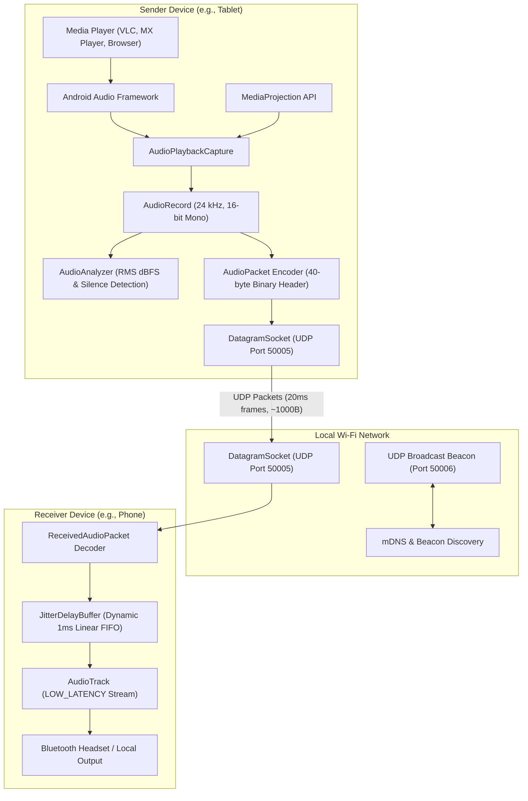
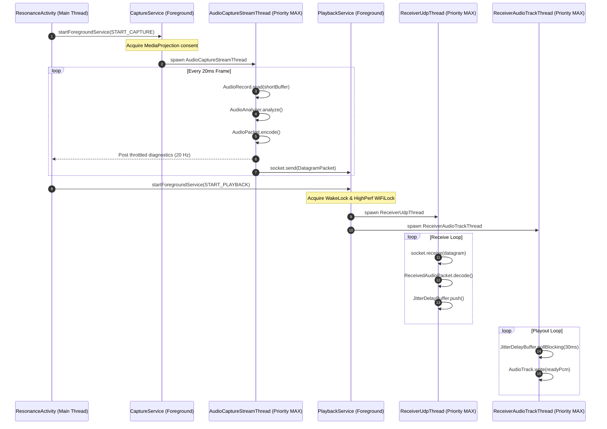

# Resonance Technical Architecture

This document details the internal design, networking protocols, synchronization mechanics, and threading models implemented in **Resonance**.

---

## 1. High-Level System Overview

Resonance provides a pure software-driven audio relay system between Android devices across a local Wi-Fi network. Both sender and receiver capabilities reside within a single Android application (`com.br.resonance`), selectable at runtime.



---

## 2. Audio Pipeline Specifications

| Parameter | Value | Rationale |
| :--- | :--- | :--- |
| **Sample Rate** | 24,000 Hz | High-intelligibility voice/media audio while keeping packet payload size small (480 samples = 960 bytes per 20 ms frame). Fits comfortably within standard 1500-byte MTU without IP fragmentation. |
| **Audio Format** | 16-bit Linear PCM | Native uncompressed format. Avoids CPU compression/decompression latency (e.g., Opus/AAC codec latency). |
| **Channel Count** | 1 (Mono) | Minimizes bandwidth usage (384 kbps audio stream), reducing contention and packet drop on congested Wi-Fi channels. |
| **Frame Duration** | 20 ms | Standard real-time audio frame size (50 packets per second). |
| **Payload Size** | 960 bytes | $24000 \text{ samples/sec} \times 2 \text{ bytes/sample} \times 0.020 \text{ sec} = 960 \text{ bytes}$. |
| **Header Size** | 40 bytes | Custom binary header with monotonic sequence numbers, timestamps, and session identifiers. |
| **Total Datagram** | 1,000 bytes | $40 \text{ bytes header} + 960 \text{ bytes payload} = 1000 \text{ bytes} \ll 1472 \text{ bytes UDP payload max}$. |

---

## 3. Binary Packet Format (`AudioPacket`)

Resonance uses a compact 40-byte little-endian header followed by raw 16-bit PCM bytes:

```
 0                   1                   2                   3
 0 1 2 3 4 5 6 7 8 9 0 1 2 3 4 5 6 7 8 9 0 1 2 3 4 5 6 7 8 9 0 1
+-+-+-+-+-+-+-+-+-+-+-+-+-+-+-+-+-+-+-+-+-+-+-+-+-+-+-+-+-+-+-+-+
|   'D' (0x44)  |   'A' (0x41)  |  Version (1)  |   Flags (0)   |
+-+-+-+-+-+-+-+-+-+-+-+-+-+-+-+-+-+-+-+-+-+-+-+-+-+-+-+-+-+-+-+-+
|                       Session ID (Bits 0..31)                 |
+                                                               +
|                       Session ID (Bits 32..63)                |
+-+-+-+-+-+-+-+-+-+-+-+-+-+-+-+-+-+-+-+-+-+-+-+-+-+-+-+-+-+-+-+-+
|                    Sequence Number (Bits 0..31)               |
+                                                               +
|                    Sequence Number (Bits 32..63)              |
+-+-+-+-+-+-+-+-+-+-+-+-+-+-+-+-+-+-+-+-+-+-+-+-+-+-+-+-+-+-+-+-+
|                    Capture Timestamp Ms (0..31)               |
+                                                               +
|                    Capture Timestamp Ms (32..63)              |
+-+-+-+-+-+-+-+-+-+-+-+-+-+-+-+-+-+-+-+-+-+-+-+-+-+-+-+-+-+-+-+-+
|                      Sample Rate (24000)                      |
+-+-+-+-+-+-+-+-+-+-+-+-+-+-+-+-+-+-+-+-+-+-+-+-+-+-+-+-+-+-+-+-+
|       Channels (1 = Mono)     |   Format (1 = 16-bit PCM)     |
+-+-+-+-+-+-+-+-+-+-+-+-+-+-+-+-+-+-+-+-+-+-+-+-+-+-+-+-+-+-+-+-+
|                     Payload Length (960)                      |
+-+-+-+-+-+-+-+-+-+-+-+-+-+-+-+-+-+-+-+-+-+-+-+-+-+-+-+-+-+-+-+-+
|                                                               |
|                 16-bit Linear PCM Audio Payload               |
|                           (960 Bytes)                         |
|                                                               |
+-+-+-+-+-+-+-+-+-+-+-+-+-+-+-+-+-+-+-+-+-+-+-+-+-+-+-+-+-+-+-+-+
```

### Legacy Raw PCM Compatibility
`ReceivedAudioPacket.decode()` includes fallback detection for raw unheadered PCM. If an incoming UDP datagram is exactly 960 bytes and does not match the `'D','A'` magic bytes, it is wrapped with synthetic sequence and timestamp data for backwards playout compatibility.

---

## 4. Jitter Buffer and Synchronization Mechanics (`JitterDelayBuffer`)

### The 1-Millisecond FIFO Architecture
At 24,000 Hz 16-bit mono:
$$\text{Bytes per Millisecond} = \frac{24000 \times 2}{1000} = 48 \text{ bytes/ms}$$

`JitterDelayBuffer` operates as a thread-safe byte ring buffer with 2000 ms capacity ($96,000 \text{ bytes}$):
- **Base Cushion**: Default baseline cushion of 80 ms ($3,840 \text{ bytes}$) buffers sufficient headroom against wireless packet jitter.
- **Minimum Safe Hardware Cushion**: Hard limit at 20 ms to prevent continuous AudioTrack starvation.
- **Positive Delay Adjustment (Adding Delay)**: When the user increases delay, `currentTargetMs` increases. Playout momentarily pauses into a pre-roll state until the buffer accumulates the new cushion depth, delaying playout smoothly without clicks.
- **Negative Delay Adjustment (Trimming Latency)**: When the user decreases delay, the exact delta in milliseconds is converted to bytes ($\Delta \text{ms} \times 48 \text{ bytes}$) and sliced from the head of the buffer via `System.arraycopy()`. This catches up immediately without requiring audio pitch-shifting or phase degradation.

---

## 5. Threading Model and OS Protections



### Foreground Service & WakeLocks
1. **Sender (`CaptureService`)**: Declared with `foregroundServiceType="mediaProjection"`. Displays persistent capture notification with active receiver count.
2. **Receiver (`PlaybackService`)**: Declared with `foregroundServiceType="mediaPlayback"`. Acquires `PowerManager.PARTIAL_WAKE_LOCK` and `WifiManager.WIFI_MODE_FULL_HIGH_PERF` to maintain active Wi-Fi radio and CPU execution even when the screen is locked.

---

## 6. Device Discovery Architecture

Resonance implements a dual-discovery protocol:
1. **Network Service Discovery (mDNS / DNS-SD)**:
   - Service Type: `_dualaudio._udp.`
   - Service Name: `DualAudio-[Manufacturer]_[Model]`
   - Port: `50005`
2. **UDP Broadcast Beacon**:
   - Port: `50006`
   - Receivers broadcast `DUAL_AUDIO_ANNOUNCE:name=[Device]:port=50005` every 2.5 seconds.
   - Senders broadcast `DUAL_AUDIO_PING` upon startup, and receivers reply with `DUAL_AUDIO_PONG`.
   - Bypasses routers with broken mDNS packet reflection.
3. **Manual IP Fallback**:
   - Allows explicit IPv4 entry stored persistently in `SharedPreferences`.

---

## 7. Feature Implementation Status

| Feature | Implementation State | Verification Status | Notes |
| :--- | :--- | :--- | :--- |
| **Audio Playback Capture** | Implemented | Verified on Android 10+ | Requires MediaProjection user consent |
| **Single-App Mode Switch** | Implemented | Verified | Sender and Receiver coexist in one APK |
| **UDP Network Streaming** | Implemented | Verified | Port 50005, 40-byte custom header |
| **Multi-Receiver Broadcast** | Implemented | Verified in code | Streams to up to 5 unicast endpoints |
| **Jitter Delay Buffer** | Implemented | Verified via unit tests | 1 ms linear byte resolution |
| **Manual Delay Slider** | Implemented | Verified in UI | Fine-tune sync between headsets |
| **Auto-Discovery (mDNS/Beacon)**| Implemented | Implemented | Requires local Wi-Fi without client isolation |
| **Real-Time Diagnostics** | Implemented | Verified | Live RMS dBFS, frame counters, throughput |
| **In-App GitHub Updates** | Implemented | Verified via unit tests | Asynchronous check against GitHub API |
| **In-App APK Sharing** | Implemented | Verified | Bluetooth / Quick Share via FileProvider |
| **Audio Compression (Opus)** | Unsupported / Planned | Planned | Currently raw 16-bit PCM |
| **DRM Protected Content** | Unsupported | Blocked by Android OS | Hardware Widevine L1 cannot be captured |
